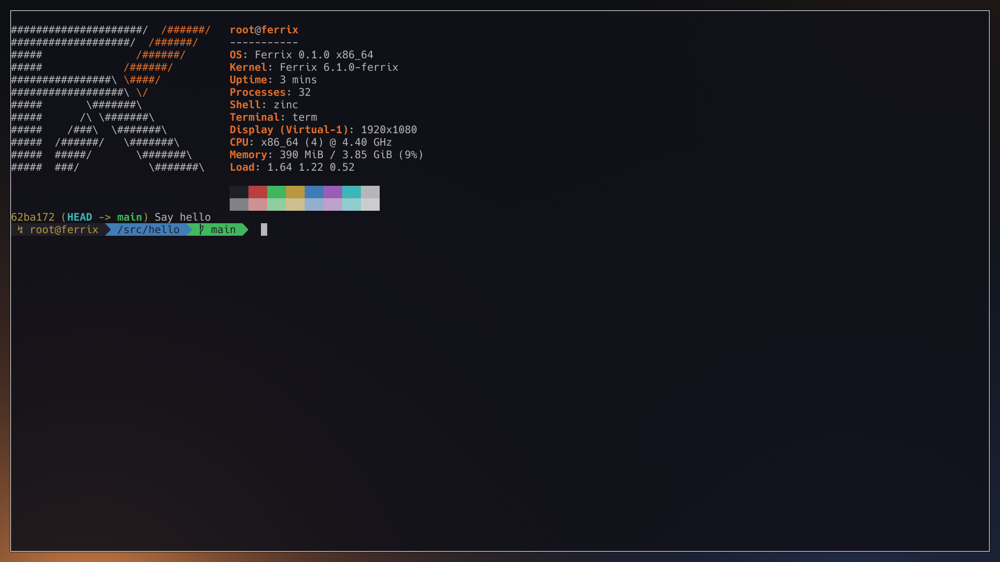

# term

term: Xaqu's terminal emulator, a pseudoterminal, a character grid and a Wayland window. An app (Xaqu's [docs/APPS.md](https://github.com/xaqu-os/xaqu/blob/main/docs/APPS.md)): `app.toml` says what it installs and how it is built; its licence is `MIT AND Bitstream-Vera`. Every desktop carries it whether or not the app is installed.

*term, Xaqu's own terminal emulator, with zinc in it running ferrofetch and git. On Xaqu (x86-64 under KVM) at main def906ba2, 2026-10-04; nothing edited after capture.*
